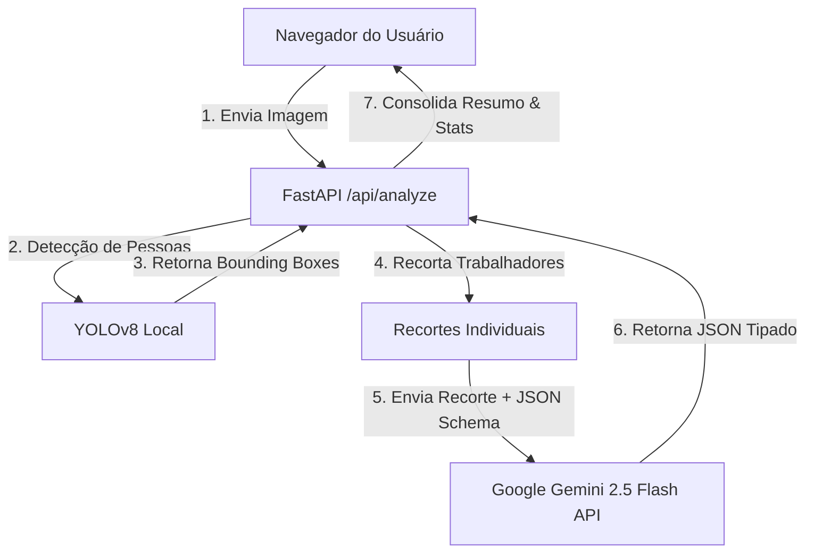

# PLAN-ollama-to-gemini.md — Integração com Google Gemini API e Novos EPIs

Este documento apresenta o plano estratégico e técnico para substituir por completo o processamento local do **Ollama (LLaVA/Gemma)** pelo **Google Gemini API (Gemini 2.5 Flash)** no **VisionAI**, integrando suporte para novas classificações de EPI/Acessórios (**óculos de proteção** e **boné**) e atualizando a interface gráfica do usuário.

> [!NOTE]
> A cópia oficial deste plano de implementação está arquivada em [docs/PLAN-ollama-to-gemini.md](file:///c:/projects_joojjuuk/Fatec/visionai/docs/PLAN-ollama-to-gemini.md).

---

## 🎯 Objetivos da Mudança

1. **Substituição Definitiva do Ollama:** Remover as referências, rotas de status e chamadas do Ollama do backend, liberando memória local e simplificando os pré-requisitos do sistema.
2. **Integração com Google Gemini API (VLM na Nuvem):**
   - Utilizar o modelo multimodal **Gemini 2.5 Flash** para analisar os recortes (`crops`) de cada trabalhador.
   - Enviar a chave de API fornecida de forma segura via variáveis de ambiente (`.env`).
   - Usar **Saídas Estruturadas (Structured Outputs)** nativas da API do Gemini para obter respostas em JSON 100% confiáveis e tipadas.
3. **Novas Classificações de EPI/Acessórios:**
   - Além de **Capacete** (`helmet`) e **Colete** (`vest`), a IA agora também classificará a presença de **Óculos de Proteção** (`glasses`) e **Boné** (`cap`).
   - O boné atuará como um indicador de alerta, pois o uso de boné muitas vezes impede a colocação correta do capacete regulamentar.
4. **Atualização da Interface Gráfica:**
   - Adaptar o painel lateral do frontend para listar todos os 4 itens auditados de cada trabalhador.
   - Criar novos ícones e badges visuais premium para representar **Óculos** e **Boné** nos estados Conforme/Inconforme/Alerta.

---

## 🗺️ Arquitetura do Fluxo Atualizado



---

## 🛠️ Tecnologias e Configurações

### Backend
- **Biblioteca Client:** Chamadas assíncronas diretas via `httpx.AsyncClient` para a API REST oficial do Gemini (`https://generativelanguage.googleapis.com/v1beta/`) ou via SDK oficial do Google. O uso de chamadas HTTP diretas reduz dependências adicionais e funciona perfeitamente com Pydantic para o JSON Schema.
- **Modelo:** `gemini-2.5-flash` (ultrarrápido, barato/gratuito e excelente em raciocínio visual).
- **JSON Schema Output:** Forçar o Gemini a responder exatamente com o seguinte formato:
  ```json
  {
    "helmet": boolean,
    "vest": boolean,
    "glasses": boolean,
    "cap": boolean,
    "description": string
  }
  ```

### Frontend
- **Componentes React:** Atualização de `BoundingBoxes.jsx`, `ResultsScreen.jsx` and `Icons.jsx` para suportar renderização de 4 flags em vez de 2.
- **Estilos CSS:** Inclusão de estados com cores adequadas (ex: óculos conforme = verde, boné presente = laranja/alerta de segurança).

---

## 🏃‍♀️ Cronograma de Tarefas (Task Breakdown)

### 🧱 FASE 1: Limpeza do Ollama e Configuração (P0)
**Foco:** Remover dependências do Ollama do backend, ajustar o arquivo `.env` com a nova chave e criar as configurações no FastAPI.

#### Tarefa 1.1: Atualizar Configurações do Backend (`config.py`)
- **Agente:** `backend-specialist`
- **Skill:** `dex-clean-code`
- **Input:** Arquivo `backend/app/config.py`.
- **Output:** 
  - Remoção das variáveis `ollama_url`, `ollama_model` e `llava_model`.
  - Inclusão de `gemini_api_key: str = ""` (carregada do `.env` como `GEMINI_API_KEY`).
  - Alteração dos modos de detecção aceitos para: `"gemini"` (padrão) e `"yolo"`.
- **Verificação:** Executar o backend e certificar-se de que as configurações carregam sem erros.

#### Tarefa 1.2: Configurar Variáveis de Ambiente (`.env`)
- **Agente:** `backend-specialist`
- **Skill:** `dex-clean-code`
- **Input:** Arquivo `backend/.env` (ou arquivo de exemplo).
- **Output:** Configuração das variáveis:
  ```env
  DETECTION_MODE=gemini
  GEMINI_API_KEY=AQ.Ab8RN6K0wzvt3PiK5Qoqvw6fIs72K2QdHO33gs7M1S4KDoSEVg
  ```
- **Verificação:** Garantir que o valor da chave é importado corretamente nas configurações.

---

### 🧠 FASE 2: Implementação do Serviço Gemini (P0)
**Foco:** Criar o novo serviço de integração que fará a chamada multimodal para o Gemini e retornará a classificação estruturada.

#### Tarefa 2.1: Criar Serviço Gemini (`gemini_service.py`)
- **Agente:** `backend-specialist`
- **Skill:** `dex-api-patterns`
- **Input:** Criação de `backend/app/services/gemini_service.py`.
- **Output:** 
  - Função assíncrona `analyze_worker_epi(image_path, person, worker_id)`.
  - Implementar corte (`crop`) otimizado da imagem da pessoa com padding adequado.
  - Montar a chamada assíncrona HTTP POST para:
    `https://generativelanguage.googleapis.com/v1beta/models/gemini-2.5-flash:generateContent?key={settings.gemini_api_key}`
  - Passar o payload estruturado contendo a imagem em base64 e o prompt em português ou inglês solicitando a análise de capacete, colete refletivo, óculos de segurança e boné.
  - Utilizar a propriedade `responseSchema` no payload para forçar a API do Gemini a retornar o JSON validado contendo as chaves `helmet`, `vest`, `glasses`, `cap` e `description`.
- **Verificação:** Criar um script de teste unitário rápido para rodar o serviço com uma imagem de teste e validar se o retorno vem no formato JSON esperado com as novas chaves.

#### Tarefa 2.2: Remover e Substituir o Serviço do Ollama
- **Agente:** `backend-specialist`
- **Skill:** `dex-clean-code`
- **Input:** Remoção de `backend/app/services/ollama_service.py`.
- **Output:** Arquivo excluído, garantindo que não existam referências órfãs.

---

### 🔌 FASE 3: Integração do Pipeline e Rotas do Backend (P1)
**Foco:** Atualizar a pipeline principal e as rotas para incluir os novos atributos detectados.

#### Tarefa 3.1: Atualizar Pipeline (`pipeline.py`)
- **Agente:** `backend-specialist`
- **Skill:** `dex-clean-code`
- **Input:** Arquivo `backend/app/services/pipeline.py`.
- **Output:** 
  - Ajustar o seletor `_get_analyzer()` para mapear o modo `gemini` para o `gemini_service`.
  - Atualizar o esquema de retorno do pipeline para incluir `glasses` e `cap` em cada objeto de `detections`.
  - No modo local `yolo` (que usa processamento HSV local), retornar valores padrão `false` ou heurísticas simples para `glasses` e `cap` para não quebrar a tipagem do frontend.
- **Verificação:** Executar uma chamada à rota `/api/analyze` e validar se a resposta JSON retornada contém o array completo com todos os novos campos.

#### Tarefa 3.2: Atualizar Rota de Status (`router.py`)
- **Agente:** `backend-specialist`
- **Skill:** `dex-api-patterns`
- **Input:** Arquivo `backend/app/api/router.py`.
- **Output:** 
  - Rota de status `/api/status` atualizada para remover a checagem de conexão do Ollama.
  - Incluir checagem rápida de validade/presença da chave `GEMINI_API_KEY`.
- **Verificação:** Chamar `GET /api/status` no navegador ou Swagger e verificar se o JSON retorna `"gemini": "configured"`.

---

### 🎨 FASE 4: Atualização da Interface do Frontend (P2)
**Foco:** Exibir de forma visualmente rica e fluida os novos itens auditados (Óculos e Boné) no painel de resultados e nas caixas interativas.

#### Tarefa 4.1: Atualizar Ícones e Badges (`Icons.jsx` & `ResultsScreen.jsx`)
- **Agente:** `frontend-specialist`
- **Skill:** `dex-frontend-design`
- **Input:** `frontend/src/components/Icons.jsx` e `frontend/src/screens/ResultsScreen.jsx`.
- **Output:** 
  - Adicionar ícones de óculos e boné (ou alerta).
  - Atualizar o painel lateral de detalhes do trabalhador selecionado para listar:
    * **Capacete:** Conforme (Verde) / Inconforme (Vermelho)
    * **Colete:** Conforme (Verde) / Inconforme (Vermelho)
    * **Óculos de Segurança:** Conforme (Verde) / Inconforme (Vermelho)
    * **Boné Detectado:** Alerta (Laranja - caso esteja usando boné embaixo do capacete) / Sem Boné (Verde/Neutro)
- **Verificação:** Checar se a sidebar de estatísticas exibe os badges perfeitamente alinhados e estilizados no padrão visual premium do VisionAI.

#### Tarefa 4.2: Atualizar Tooltips e Caixas Interativas (`BoundingBoxes.jsx`)
- **Agente:** `frontend-specialist`
- **Skill:** `dex-frontend-design`
- **Input:** `frontend/src/components/BoundingBoxes.jsx`.
- **Output:**
  - Atualizar o tooltip exibido ao passar o mouse ou clicar em uma caixa delimitadora sobre a imagem.
  - Mostrar os pequenos ícones/indicadores dos 4 itens diretamente no cabeçalho ou corpo do tooltip rápido.
- **Verificação:** Passar o mouse sobre um trabalhador e verificar se todos os 4 status aparecem de maneira limpa e legível.

---

## 🏁 PHASE X: Final Verification (MANDATORY CHECKS)

Para garantir qualidade excepcional e zero regressões:

1. **Varredura de Segurança (P0):**
   - Garantir que a `GEMINI_API_KEY` real não seja exposta diretamente no código fonte (ela DEVE ficar estritamente no arquivo `.env` e carregada via `pydantic`).
   ```bash
   python .agent/skills/dex-security-scan/scripts/security_scan.py .
   ```
2. **Auditoria de UX & Acessibilidade (P1):**
   - Garantir que os novos indicadores de Óculos e Boné tenham excelente contraste de cores e não quebrem o grid ou a responsividade do sidebar.
   ```bash
   python .agent/skills/dex-frontend-design/scripts/ux_audit.py .
   ```
3. **Validação da Build Completa:**
   - Rodar a build estática do frontend para garantir compilação sem falhas:
     ```bash
     cd frontend && npm run build
     ```
   - Iniciar o servidor FastAPI local integrado e testar o fluxo de ponta a ponta com uma imagem real.

---

### ✅ Definição de Concluído (Done When)
- [ ] O serviço do Ollama foi removido e a dependência local cessou.
- [ ] O modo padrão do backend utiliza a API do Gemini via variável de ambiente.
- [ ] A análise do trabalhador classifica Capacete, Colete, Óculos e Boné.
- [ ] O frontend exibe os 4 atributos no painel lateral de conformidade.
- [ ] O tooltip da bounding box renderiza os novos itens de forma visualmente rica.
- [ ] A build estática final compila sem warnings ou erros.
