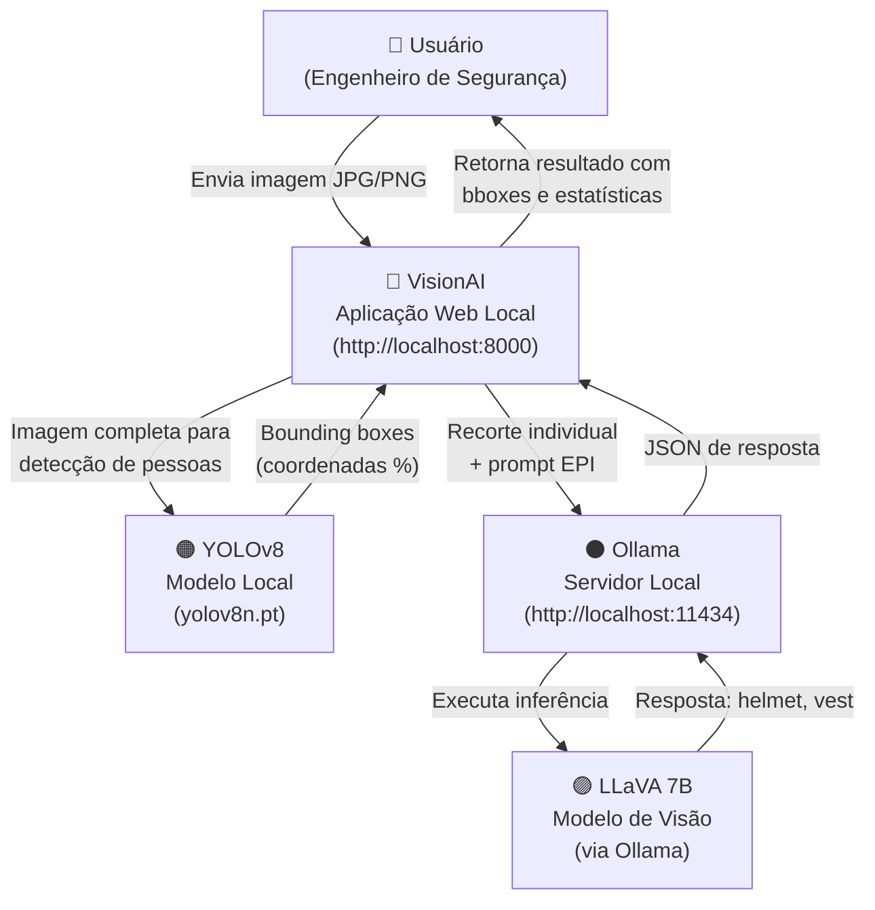
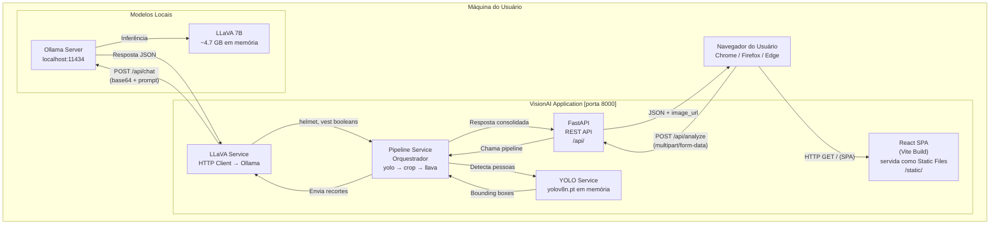

# Arquitetura do Sistema — VisionAI

> Documento arquitetural técnico do VisionAI MVP.
> Baseado no modelo C4 (Context → Container → Component).

---

## Seção 1: Contexto Executivo & Goals Técnicos

### O que o sistema faz

O VisionAI é uma aplicação web local de auditoria de EPIs (Equipamentos de Proteção Individual). Recebe uma imagem estática de um canteiro de obras, detecta trabalhadores via YOLOv8, analisa individualmente cada recorte via LLaVA/Ollama, e devolve ao usuário a imagem com marcações interativas de conformidade (verde/vermelho).

### Trade-offs Fundamentais Fixados

| Decisão | Escolha | Alternativa Descartada | Motivo |
|---------|---------|----------------------|--------|
| Modelo de detecção | YOLOv8 | LLaVA para bbox | YOLOv8 é especializado em coordenadas precisas; LLaVA não retorna bbox confiáveis |
| Análise de EPI | LLaVA (generalista) | YOLO treinado para EPI | MVP sem dataset de treinamento disponível; LLaVA generalista suficiente para demo |
| Execução | 100% local (offline) | API na nuvem | Privacidade de dados e sem custo de infra |
| Renderização de bboxes | React no browser | Pillow no backend | Mantém interatividade (hover, filtros, painel reativo) |
| Servidor | FastAPI único | Frontend separado | Simplicidade operacional — um único `python run.py` |
| Processamento | Síncrono por imagem | Batch/filas | MVP: uma imagem por vez; complexidade desnecessária |

---

## Seção 2: Visão C4 Level 1 — System Context



**Atores externos:**
- **Usuário:** Engenheiro ou fiscal de segurança do trabalho que precisa auditar EPIs visualmente de forma rápida.

**Sistemas locais consumidos:**
- **YOLOv8 (Ultralytics):** Modelo COCO-pretrained carregado diretamente em Python. Não requer servidor separado.
- **Ollama:** Servidor de modelos LLM locais. Expõe API REST HTTP em `localhost:11434`.
- **LLaVA 7B:** Modelo de linguagem + visão servido pelo Ollama.

---

## Seção 3: Visão C4 Level 2 — Container Level



### Containers e Responsabilidades

| Container | Tech | Responsabilidade |
|-----------|------|-----------------|
| **React SPA** | React 18 + Vite | UI, estado de telas (upload/loading/results), renderização de bboxes interativas |
| **FastAPI** | Python 3.10, Uvicorn | Roteamento HTTP, validação de upload, orquestração de serviços |
| **YOLO Service** | ultralytics, PyTorch | Carrega modelo em memória, executa inferência, retorna bbox em % |
| **LLaVA Service** | httpx (async) | Recorta imagens via Pillow, codifica base64, consulta Ollama, parseia resposta |
| **Pipeline** | Python puro | Orquestra YOLO → Crop → LLaVA, consolida JSON de resposta com stats |
| **Ollama Server** | Processo externo | Serve modelos LLM localmente via API REST |

---

## Seção 4: Fluxo de Dados

### Fluxo Completo de uma Requisição

```
1. Usuário seleciona imagem no browser
2. POST /api/analyze (multipart/form-data) → FastAPI
3. FastAPI salva imagem em /uploads/<uuid>.jpg
4. Pipeline.run(image_path) é chamado
5.   → YOLOService.detect_people(image_path)
         Carrega imagem com Pillow
         Executa YOLO: model(image_path, classes=[0]) # 0 = person
         Converte bbox absolutas → coordenadas em % da imagem
         Retorna: [{id, x%, y%, w%, h%, confidence}, ...]
6.   → Para cada pessoa detectada:
         LLaVAService.analyze_epi(image_path, bbox)
           Pillow.crop(bbox_pixels) → sub-imagem
           Base64.encode(crop_bytes)
           POST ollama:11434/api/chat {model, messages: [{image, prompt}]}
           Parseia resposta: extrai JSON {helmet: bool, vest: bool}
7.   Pipeline consolida resultado:
         detections: [{id, x, y, w, h, confidence, helmet, vest, role}, ...]
         stats: {total, ok, bad, pct, duration_seconds}
         image_url: "/uploads/<uuid>.jpg"
8. FastAPI retorna JSON ao browser
9. React recebe JSON, renderiza imagem real + bboxes interativas sobrepostas
```

### Formato do JSON de Resposta da API

```json
{
  "image_url": "/uploads/a3f9c1b2.jpg",
  "image_width": 1920,
  "image_height": 1200,
  "duration_seconds": 12.4,
  "detections": [
    {
      "id": 1,
      "x": 10.5,
      "y": 48.2,
      "w": 8.3,
      "h": 34.1,
      "confidence": 0.94,
      "helmet": true,
      "vest": false,
      "role": "Trabalhador 01"
    }
  ],
  "stats": {
    "total": 6,
    "ok": 4,
    "bad": 2,
    "pct": 67
  }
}
```

### Prompt Enviado ao LLaVA (por pessoa)

```
You are a workplace safety inspector analyzing PPE (Personal Protective Equipment) compliance.
Look carefully at this cropped image of a single construction worker.

Determine with high confidence:
1. Is the person wearing a safety helmet/hard hat?
2. Is the person wearing a reflective safety vest?

Respond ONLY with a valid JSON object, no explanation:
{"helmet": true, "vest": false}
```

### Política de Dados

- Imagens são salvas em `/uploads/` apenas durante o processamento
- Não há banco de dados — sem persistência de histórico no MVP
- Nenhum dado trafega para fora da máquina local

---

## Seção 5: Segurança

### Superfície de Ataque (local)

Como toda a comunicação acontece em `localhost`, a superfície de ataque é mínima. Ainda assim, aplicamos:

| Controle | Implementação |
|----------|---------------|
| Validação de arquivo | Aceitar apenas MIME types de imagem; rejeitar executáveis |
| Tamanho máximo | Limite de 10 MB por upload (FastAPI `File(...)` com `max_size`) |
| Sanitização de nome | UUID gerado pelo backend — sem uso do nome original do arquivo em paths |
| CORS | Em dev: Vite proxy. Em prod: FastAPI serve o próprio frontend, sem CORS |
| Upload path traversal | Uploads sempre em `/uploads/<uuid>.<ext>` — sem uso de input do usuário em paths |

### Sem Autenticação (MVP local)

Por ser um sistema local single-user, não há autenticação no MVP. Versões futuras com multiusuário e histórico deverão adicionar autenticação.

---

## Seção 6: Deploy & Observabilidade

### Fluxo de Build (Produção Local)

```bash
# run.py executa em sequência:
1. cd frontend && npm run build        # Compila React → /frontend/dist/
2. Copia /frontend/dist/ → /backend/static/
3. uvicorn app.main:app --port 8000   # FastAPI serve static + API
```

### Configuração do FastAPI (Servidor Único)

```python
# backend/app/main.py
from fastapi.staticfiles import StaticFiles

app = FastAPI()
app.include_router(api_router, prefix="/api")

# Serve o frontend compilado
app.mount("/uploads", StaticFiles(directory="uploads"), name="uploads")
app.mount("/", StaticFiles(directory="static", html=True), name="static")
```

### Logs e Observabilidade

```
[Estruturado via Python logging]
INFO:     Uvicorn running on http://127.0.0.1:8000
INFO:     YOLO model loaded: yolov8n.pt
INFO:     Ollama connected: llava:7b
INFO:     POST /api/analyze - 200 - 12.4s
INFO:     Detected 6 persons (avg confidence: 0.91)
INFO:     Person 1: helmet=True, vest=False [LLaVA 2.1s]
INFO:     Person 2: helmet=True, vest=True  [LLaVA 1.9s]
```

### Escalabilidade (Fora do Escopo do MVP)

Para produção futura com múltiplos usuários:
- Substituir LLaVA por modelo YOLO treinado especificamente para EPIs (mais rápido e preciso)
- Implementar fila de jobs (Celery + Redis) para processar múltiplas imagens em paralelo
- Adicionar cache de resultados por hash da imagem

---

## Seção 7: Registro de Decisões (ADRs)

| # | Decisão | Escolha | Alternativa | Motivo |
|---|---------|---------|-------------|--------|
| ADR-001 | Stack de detecção | YOLOv8n (ultralytics) | Detectron2, MMDetection | API Python mais simples, modelo pré-treinado sem configuração, mais lento mas suficiente para MVP |
| ADR-002 | Modelo de análise EPI | LLaVA 7B via Ollama | CLIP, modelo YOLO customizado | MVP sem dataset de EPIs para treino; LLaVA generalista funciona como prova de conceito |
| ADR-003 | Frontend | React + Vite | Vue, Svelte | Ecossistema familiar, build rápida, JSX expressivo para o componente de bboxes interativas |
| ADR-004 | CSS | Vanilla CSS + tokens HSL | Tailwind, Styled Components | Sem overhead de runtime, controle total dos tokens de design, dark mode via `[data-theme]` |
| ADR-005 | Renderização de bbox | React no browser | Pillow no backend | Interatividade gratuita (hover, filtros, painel reativo sincronizado) |
| ADR-006 | Servidor | FastAPI único | Nginx + 2 servers | Simplicidade máxima para MVP local (`python run.py`) |
| ADR-007 | Persistência | Nenhuma (sem DB) | SQLite, PostgreSQL | MVP de demonstração; histórico e relatórios são features futuras |
| ADR-008 | Upload de arquivos | UUID no backend | Nome original do arquivo | Segurança: evita path traversal e colisões |

---

*Documento gerado como parte do VisionAI MVP — FATEC*
*Modelo C4 adaptado para aplicação local offline*
