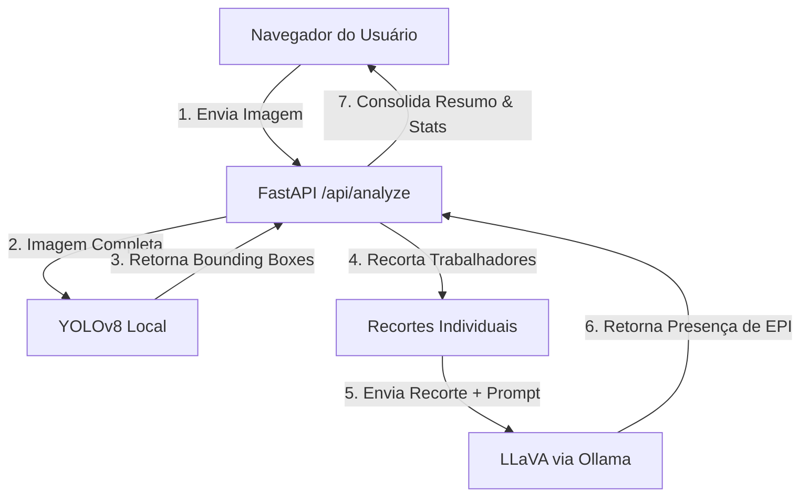

# PLAN-visionai-mvp.md — Plano de Implementação VisionAI

Este documento apresenta o plano estratégico detalhado para realizar o **desmock do MVP do VisionAI**, transformando o protótipo estático local em um sistema integrado real e de alto nível técnico, rodando inteiramente em ambiente offline local.

---

## 🎯 Visão Geral do Sistema

O **VisionAI** é uma ferramenta local de auditoria de conformidade de EPIs (Equipamentos de Proteção Individual) para canteiros de obras. 
- **Entrada:** Uma imagem estática (JPG, PNG ou WebP) enviada pelo usuário.
- **Processamento:** 
  1. **YOLOv8** local detecta todas as pessoas na cena e retorna suas bounding boxes (coordenadas relativas).
  2. O backend recorta a região de cada pessoa detectada.
  3. **LLaVA via Ollama** analisa individualmente cada recorte para determinar se o trabalhador está usando **capacete** e **colete refletivo**.
- **Saída:** O frontend exibe a imagem original e plota caixas de marcação (`BoundingBoxes`) dinâmicas e interativas sobre a imagem. Um painel lateral apresenta estatísticas consolidadas e o status individual de cada trabalhador.

---

## 🗺️ Tipo do Projeto e Arquitetura

- **Tipo do Projeto:** `WEB` + `BACKEND` (Single Server local)
- **Arquitetura de Alta Performance:**
  - **Frontend:** Aplicação moderna modular baseada em **React + Vite**, com estilos CSS sob medida (sem frameworks pesados de templates prontos) mantendo a rica estética visual azul, dark/light mode e tweaks.
  - **Backend:** Servidor assíncrono em **FastAPI (Python)**, que empacota e serve os arquivos estáticos compilados do frontend na raiz `/` e gerencia a API de processamento local sob a rota `/api`.
  - **Visão Computacional & LLM:**
    - **YOLOv8 (Ultralytics):** Carregado em memória diretamente pelo Python, agilizando a detecção de pessoas.
    - **LLaVA (via Ollama):** Consultas assíncronas via cliente HTTP `httpx` para inferência de visão multimodal local rápida.



---

## 🛠️ Tech Stack & Racional

### Backend
- **Python 3.10+**: Linguagem padrão da indústria para visão computacional.
- **FastAPI + Uvicorn**: Servidor assíncrono ultrarrápido para manipulação de I/O de imagem.
- **Ultralytics (YOLOv8)**: Biblioteca oficial para carregar o modelo `yolov8n.pt` localmente. Extremamente rápido (~100ms CPU/GPU).
- **HTTPX**: Cliente assíncrono para fazer chamadas HTTP não-bloqueantes ao Ollama local.
- **Pillow (PIL)**: Biblioteca padrão para recortar as sub-imagens de cada pessoa com base nas bounding boxes do YOLOv8 e opcionalmente preparar imagens em memória.

### Frontend
- **React 18 & Vite**: Para uma build ultra-veloz, modularização completa dos componentes e excelente gerenciamento de estados reativos.
- **Vite Proxy**: Configurado em desenvolvimento para redirecionar `/api` ao FastAPI (`http://localhost:8000`), permitindo Hot Module Replacement (HMR) em tempo real.
- **Vanilla CSS (HSL Variables)**: Preserva o visual premium do protótipo com suporte a temas e micro-animações.

---

## 📁 Estrutura de Diretórios Proposta

Reestruturaremos o diretório de forma limpa, separando a aplicação em `/frontend` e `/backend`:

```text
visionai/
├── PLAN-visionai-mvp.md        # Este plano
├── run.py                      # Script unificado para rodar a aplicação local
├── backend/                    # Servidor FastAPI
│   ├── app/
│   │   ├── __init__.py
│   │   ├── main.py             # Inicializa app, monta pasta static e inclui as rotas
│   │   ├── config.py           # Variáveis (OLLAMA_URL, YOLO_MODEL, UPLOAD_DIR)
│   │   ├── api/
│   │   │   ├── __init__.py
│   │   │   └── router.py       # Rotas: POST /api/analyze, GET /api/status
│   │   └── services/
│   │       ├── __init__.py
│   │       ├── yolo_service.py # Lógica de detecção do YOLOv8
│   │       ├── llava_service.py# Chamadas assíncronas ao LLaVA no Ollama
│   │       └── pipeline.py     # Orquestrador YOLO -> Recorte -> LLaVA -> Relatório
│   ├── static/                 # Onde a build do frontend será montada e servida
│   ├── uploads/                # Armazenamento temporário de uploads (opcional)
│   └── requirements.txt        # Dependências python (fastapi, ultralytics, pillow, httpx)
└── frontend/                   # Aplicação React modularizada
    ├── package.json
    ├── vite.config.js
    ├── index.html
    └── src/
        ├── main.jsx
        ├── App.jsx             # Gerencia os estados de upload/loading/results
        ├── index.css           # Copiado e aprimorado a partir do styles.css original
        ├── components/
        │   ├── Icons.jsx       # SVGs do components.jsx
        │   ├── BrandMark.jsx
        │   ├── TopBar.jsx
        │   ├── BoundingBoxes.jsx # Caixas interativas sobrepostas
        │   └── TweaksPanel.jsx  # Painel de tweaks
        └── screens/
            ├── UploadScreen.jsx
            ├── LoadingScreen.jsx
            └── ResultsScreen.jsx
```

---

## 📝 Success Criteria (Critérios de Sucesso)

- [ ] **Sem mocks no processamento real**: O upload de uma foto real deve disparar a inferência YOLOv8 + LLaVA local.
- [ ] **Respostas precisas**: O sistema deve retornar as bounding boxes exatas em % e o status booleano para `helmet` e `vest`.
- [ ] **Interatividade preservada**: O frontend deve carregar a imagem real enviada pelo usuário e sobrepor as bounding boxes dinâmicas com comportamento de hover/clique funcional.
- [ ] **Consistência de estilo**: O sistema mantém o modo escuro, modo claro e a rica paleta azul/cinza original.
- [ ] **Servidor Único**: Executando o backend em produção, ele serve o frontend no mesmo endereço IP e porta.
- [ ] **Desempenho**: Logs detalhados no frontend (stderr do pipeline) exibindo em tempo real as etapas concluídas e tempos de resposta reais.

---

## 🏃‍♀️ Cronograma de Tarefas (Task Breakdown)

### 🧱 FASE 1: Fundação do Backend (P0)
**Foco:** Configurar o ambiente Python, estruturar o FastAPI e validar o funcionamento das IAs isoladas.

#### Tarefa 1.1: Estrutura Inicial e Dependências do Backend
- **Agente:** `backend-specialist`
- **Habilidade:** `dex-nodejs` (python setup)
- **Input:** Criação de `backend/requirements.txt` e `backend/app/config.py`.
- **Output:** Pasta `backend/` criada, dependências python instaladas (`fastapi`, `uvicorn`, `ultralytics`, `pillow`, `httpx`).
- **Verificação:** Executar `pip install -r backend/requirements.txt` e verificar importação bem-sucedida de `ultralytics` e `fastapi`.

#### Tarefa 1.2: Wrapper do YOLOv8 para Detecção de Pessoas
- **Agente:** `backend-specialist`
- **Habilidade:** `dex-python`
- **Input:** Arquivo `backend/app/services/yolo_service.py`. Carrega `yolov8n.pt` local.
- **Output:** Função `detect_people(image_path)` que recebe uma imagem, roda o YOLOv8 e retorna uma lista de dicionários com as coordenadas normalizadas `(xmin, ymin, xmax, ymax)` da caixa de cada pessoa identificada, junto com a confiança.
- **Verificação:** Criar um script de teste rápido rodando o YOLOv8 contra uma imagem de exemplo e dando print nas coordenadas.

#### Tarefa 1.3: Wrapper do LLaVA via Ollama para Análise de EPI
- **Agente:** `backend-specialist`
- **Habilidade:** `dex-python`
- **Input:** Arquivo `backend/app/services/llava_service.py`.
- **Output:** Função assíncrona `analyze_worker_epi(crop_image)` que recebe um recorte em formato PIL/Bytes, codifica para base64 e envia ao Ollama no modelo `llava:7b` (ou o modelo ativo do usuário) com um prompt direto e objetivo (ex: "Determine if this person is wearing a safety helmet and a reflective safety vest. Answer strictly in JSON format: {'helmet': true/false, 'vest': true/false}").
- **Verificação:** Executar teste contra um recorte simulado de trabalhador e verificar se a resposta JSON é extraída de forma correta e robusta (mesmo se o LLaVA retornar markdown ou texto livre, usar regex ou json parser flexível).

#### Tarefa 1.4: Orquestrador da Pipeline e Rota FastAPI
- **Agente:** `backend-specialist`
- **Habilidade:** `dex-python`
- **Input:** `backend/app/services/pipeline.py` e `backend/app/api/router.py`.
- **Output:** 
  - Endpoint `POST /api/analyze` que aceita upload de arquivos (multipart/form-data).
  - Executa a pipeline assincronamente:
    1. Salva a imagem original.
    2. Roda o YOLOv8 para mapear bboxes.
    3. Para cada bbox, recorta o indivíduo usando Pillow.
    4. Consulta o LLaVA em paralelo ou sequência.
    5. Constrói o JSON final de resposta no mesmo formato de `window.DETECTIONS`:
       ```json
       {
         "image_url": "/api/static-uploads/nome_da_imagem.jpg",
         "detections": [
           { "id": 1, "x": 10, "y": 45, "w": 8, "h": 32, "helmet": true, "vest": false, "confidence": 0.94, "role": "Trabalhador 01" }
         ],
         "stats": { "total": 1, "ok": 0, "bad": 1, "pct": 0, "duration": 4.2 }
       }
       ```
- **Verificação:** Testar a rota `/api/analyze` usando cURL ou Swagger UI (`/docs`) enviando uma foto e recebendo a estrutura perfeita de resposta.

---

### 🎨 FASE 2: Fundação do Frontend React (P2)
**Foco:** Estruturar um projeto React+Vite profissional, portar e aprimorar a interface rica do protótipo.

#### Tarefa 2.1: Inicialização do Frontend React + Vite
- **Agente:** `frontend-specialist`
- **Habilidade:** `dex-frontend-design`
- **Input:** Pasta `frontend/` com setup padrão Vite+React (`package.json`, `vite.config.js`).
- **Output:** Boilerplate React funcional. O arquivo `vite.config.js` deve incluir um proxy:
  ```javascript
  proxy: {
    '/api': 'http://localhost:8000',
    '/uploads': 'http://localhost:8000'
  }
  ```
- **Verificação:** Rodar `npm run dev` no frontend e certificar que a página de boas-vindas do Vite carrega localmente.

#### Tarefa 2.2: Portabilidade do CSS e Componentização
- **Agente:** `frontend-specialist`
- **Habilidade:** `dex-frontend-design`
- **Input:** Portar os estilos do `styles.css` para `frontend/src/index.css` e estruturar os componentes utilitários em arquivos independentes em `frontend/src/components/`.
- **Output:** Componentes React modulares (`TopBar`, `BrandMark`, `Icons`, `TweaksPanel`, `BoundingBoxes`) criados e estilizados fielmente, mantendo a rica aparência premium escura/clara e HSL adaptativo.
- **Verificação:** Compilar e garantir que não existam erros de importação ou conflitos de classes.

#### Tarefa 2.3: Portabilidade e Adaptação de Telas
- **Agente:** `frontend-specialist`
- **Habilidade:** `dex-frontend-design`
- **Input:** Criar `UploadScreen.jsx`, `LoadingScreen.jsx`, e `ResultsScreen.jsx` na pasta `/screens`.
- **Output:** Telas portadas com sucesso. A tela de resultados deve passar a receber e renderizar dinamicamente a imagem do upload original vinda do backend (`image_url` dinâmico no lugar do `ScenePlaceholder` CSS padrão).
- **Verificação:** Garantir que o fluxo Upload -> Loading -> Results flua perfeitamente usando dados mocados locais do frontend antes da integração.

---

### 🔌 FASE 3: Integração e Refinamento (P1)
**Foco:** Ligar o frontend React ao servidor FastAPI, tratar o tráfego da imagem real e consolidar a experiência.

#### Tarefa 3.1: Integração do Fluxo de Upload e Análise Real
- **Agente:** `frontend-specialist` + `backend-specialist`
- **Habilidade:** `dex-frontend-design`
- **Input:** Modificar a tela de carregamento e envio no React para fazer uma chamada HTTP `multipart/form-data` real para `/api/analyze` enviando o arquivo escolhido.
- **Output:** O frontend envia a imagem, exibe as mensagens de status de carregamento, e ao receber a resposta, renderiza a imagem real enviada com as bboxes desenhadas dinamicamente sobre ela por porcentagem (`x`, `y`, `w`, `h` relativos ao tamanho da imagem na tela).
- **Verificação:** Efetuar fluxo completo com uma foto real, ver as bboxes corretas se posicionando sobre os trabalhadores reais no navegador.

#### Tarefa 3.2: Exposição Dinâmica de Logs no Pipeline
- **Agente:** `frontend-specialist`
- **Habilidade:** `dex-frontend-design`
- **Input:** Modificar a interface de logs de `LoadingScreen.jsx`.
- **Output:** Em vez de logs puramente estáticos/temporizados, o backend pode retornar respostas parciais (Server-Sent Events - SSE ou atualizações de progresso simples) ou o frontend pode simular as mensagens baseadas em eventos assíncronos reais da API.
- **Verificação:** O log stderr do pipeline no sidebar do processamento reflete o progresso real da chamada (ex: "Enviando imagem ao YOLOv8", "Detectadas N pessoas", "Analisando EPI de trabalhador 1/N...").

---

### 🚀 FASE 4: Empacotamento Single-Server e Validação (P3)
**Foco:** Compilar o projeto e preparar a entrega final em um único comando.

#### Tarefa 4.1: Script Unificado de Build e Servidor
- **Agente:** `devops-engineer`
- **Habilidade:** `dex-server-management`
- **Input:** Criar script `run.py` na raiz do projeto e script de build no `package.json` do frontend.
- **Output:** 
  - Script que gera a build estática do frontend (`npm run build`).
  - Move os arquivos da pasta `/dist` ou `/build` do React para `backend/static/`.
  - Configura o FastAPI para expor `backend/static` no endpoint raiz `/` usando `StaticFiles`.
  - Executa o servidor `uvicorn backend.app.main:app --host 127.0.0.1 --port 8000`.
- **Verificação:** Executar `python run.py` de uma pasta vazia e acessar `http://localhost:8000` para ver todo o sistema funcionando em uma única porta offline.

---

## 🏁 PHASE X: Final Verification (MANDATORY CHECKS)

Para dar o projeto como concluído com 100% de qualidade e boas práticas:

1. **Varredura de Segurança (P0):**
   ```bash
   python .agent/skills/dex-security-scan/scripts/security_scan.py .
   ```
2. **Auditoria de UX e Acessibilidade (P1):**
   ```bash
   python .agent/skills/dex-frontend-design/scripts/ux_audit.py .
   ```
3. **Validação de Build (P1):**
   - Garantir que o frontend compila 100% livre de warnings no `npm run build`.
   - Garantir que o servidor FastAPI inicializa sem erros de dependência.
4. **Verificação Visual e Temas (Manual):**
   - Testar contraste no modo claro e escuro.
   - Certificar-se de que nenhuma cor violeta ou roxo (`#purple`) foi utilizada fora da paleta corporativa azul/cinza original do VisionAI (Regra Purple Ban!).
